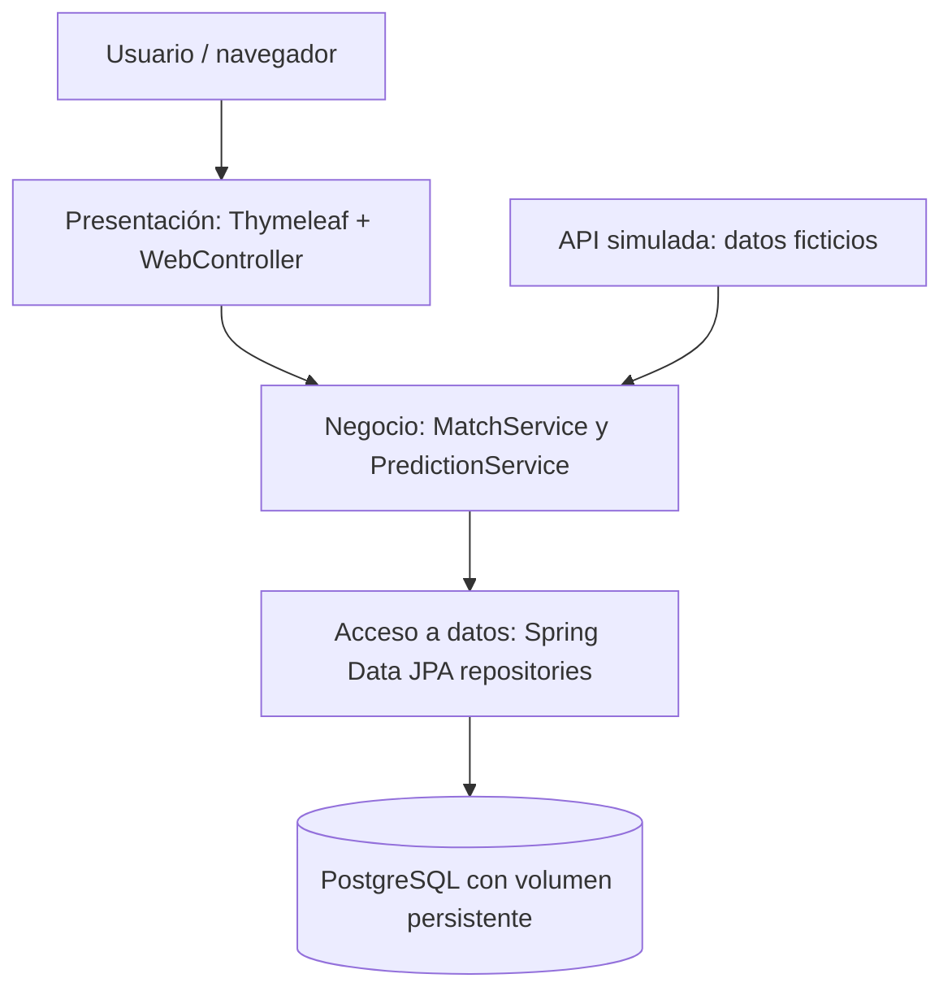

# Arquitectura de tres capas

## Flujo de datos

1. Al iniciar Spring Boot, `MatchService.run()` consume `fetchSimulatedApi()`, una fuente simulada de partidos.
2. `MatchRepository` verifica `externalId` y guarda solo partidos nuevos en PostgreSQL.
3. `GET /` consulta los partidos y predicciones mediante servicios y repositorios, y los muestra en Thymeleaf.
4. `POST /predictions` valida nombre, partido y goles, calcula automáticamente el ganador o empate y persiste la predicción relacionada con el partido.
5. `GET /` muestra el historial persistido. Los datos sobreviven a reinicios por el volumen `postgres_data`.

**Aviso:** partidos, equipos y fechas son datos inventados de demostración, no resultados ni calendario oficial.
